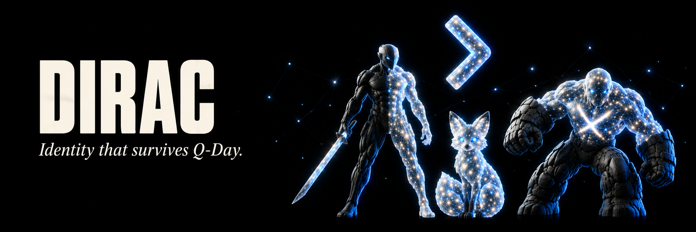

### Your identity. Your proof. Your private conversations.

**Post-quantum identity for people who use Solana.**

[**Explore Dirac**](https://dirac.digital) · [**Our mission**](#our-mission) · [**What you can do**](#what-you-can-do) · [**Quantum playground**](#learn-by-playing)

---

## Our mission

A wallet address tells people where to send a transaction. Everyday relationships need more: a way to establish an identity, prove who signed a document, and communicate privately.

**Dirac brings those capabilities together in a passport connected to your Solana wallet.** We are building practical tools that help people establish trust and use post-quantum cryptography today, with an experience they can understand and use.

Our goal is to make stronger identity and private communication accessible to wallet holders, independent creators, trading counterparties, and teams working together on-chain.

## What you can do

### Understand what your wallet controls

The **Quantum Scanner** reads your wallet's assets, authorities, and detected multisig memberships. It brings three questions into one report: what depends on this wallet key, whether a post-quantum passport exists, and how complete the available data is.

Missing data is marked as unavailable. The report helps you understand your exposure and identity status without hiding uncertainty behind a single score.

[**Scan a wallet →**](https://dirac.digital/scan)

### Create an identity people can verify

A **Quantum Passport** connects your wallet to keys for post-quantum signatures and encrypted messages. Its public page lets others inspect your identity, and its hash can be anchored on Solana as a record of that passport version.

Choose **Simple** for recovery through a wallet signature, or **Hardened** for independent keys recovered with a 24-word phrase or encrypted recovery file. Hardened separates your passport's key material from the wallet's Ed25519 secret; Simple derives its keys from the wallet signature.

Share your passport link or embed its badge so collaborators and counterparties can check the identity they are interacting with.

[**Create your passport →**](https://dirac.digital/passport)

### Give your documents verifiable proof

A **Document Seal** lets you sign a file and share proof of that signature. A recipient can check which passport signed it and whether the file still matches the signed hash.

The file is processed on your device. Dirac creates a portable `.qseal` proof, so you can verify a proposal, agreement, statement, or creative work without uploading the original document to our server.

[**Seal or verify a document →**](https://dirac.digital/seal)

### Have private conversations between wallets

The **Encrypted Inbox** lets you write to another passport directly from your wallet identity. Your browser encrypts the message before it is uploaded; the recipient decrypts it using their passport keys.

This gives collaborators and counterparties a place to exchange proposals, coordinate work, and send private notes. The service stores encrypted envelopes and routing metadata, while message contents remain encrypted.

[**Open your inbox →**](https://dirac.digital/inbox) · [**Write a message →**](https://dirac.digital/write)

## Who Dirac helps

| For | How Dirac helps |
| --- | --- |
| **Wallet holders** | Understand wallet exposure, create a passport, and share a verifiable identity. |
| **DAO and protocol teams** | Sign documents and exchange encrypted proposals or private coordination messages. |
| **Trading counterparties** | Connect a public passport to a wallet address and discuss terms through an encrypted inbox. |
| **Creators and contributors** | Give files and public statements verifiable signatures tied to their passport. |
| **People exploring quantum computing** | Learn through interactive experiments and see how the concepts connect to identity and encryption. |

## Learn by playing

Quantum computing is easier to understand when you can interact with it. Dirac's playground turns abstract ideas into experiments you can watch and influence.

| Experience | Explore |
| --- | --- |
| **[Quantum Pet](https://dirac.digital/pet)** | A shared 10-qubit simulation shaped by visitors. Apply gates, watch the probabilities change, and see the daily measurement choose the pet's next form. |
| **[Qubit Arena](https://dirac.digital/arena)** | Build two-qubit fighters, explore entanglement, and compete through circuit choices and exact probabilities. |
| **[Attack Lab](https://dirac.digital/lab)** | Explore toy demonstrations of brute force, Shor's algorithm, lattice problems, and harvest-now-decrypt-later scenarios. |

The pet also supports a weekly run on **IBM Quantum hardware** when credentials and allowance are available. Hardware results can be compared with the simulation; simulation remains the fallback when a hardware run is unavailable.

## Built around ownership and verification

**Keys are created in your browser.** Secret passport keys stay in memory, and you restore them through the recovery method you chose.

**Identity has a public proof.** Passports combine a wallet signature with a post-quantum self-signature. An on-chain anchor records the passport hash; replacing a registered passport requires a signature from its existing post-quantum key.

**Privacy starts before upload.** Messages are encrypted on your device. Documents are hashed and signed locally, so the original file can stay with you.

**The implementation is open.** Dirac uses ML-DSA-65 for signatures and ML-KEM-768 to establish encryption secrets, implemented with the `@noble` and `@scure` libraries. Solana provides the wallet connection and on-chain anchors, while the web application makes these capabilities accessible through one interface.

Dirac protects an application identity, document proofs, and encrypted conversations. Solana wallet transactions continue to use the network's existing signatures; creating a passport does not change the security of your wallet balances.

---

### Start with your wallet. Build an identity beyond it.

[**Explore Dirac at dirac.digital →**](https://dirac.digital)

**DIRAC** · Identity that survives Q-Day.

[Website](https://dirac.digital) · [Docs](https://dirac.digital/docs) · [X](https://x.com/dirac_quantum) · [GitHub](https://github.com/DiracQuantum/dirac_quantum)

