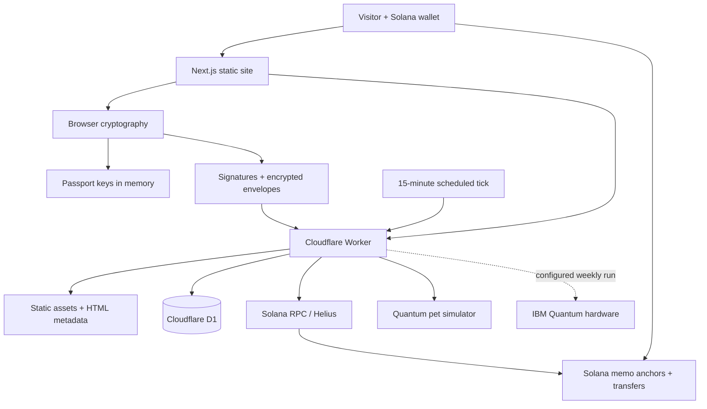

<div align="center">

### Post-quantum identity for Solana.

One wallet. A verifiable passport. Signed documents. Encrypted conversations.

[**Explore Dirac**](https://dirac.digital) · [**Source code**](https://github.com/DiracQuantum/dirac_quantum) · [**Architecture**](#how-it-is-built) · [**Run locally**](#run-locally)


</div>

---

## What is Dirac?

Dirac connects a Solana wallet to a post-quantum identity that can sign documents and receive encrypted messages. Keys are generated in the browser, the passport is bound to the wallet, and its hash can be anchored on Solana for an independently verifiable record.

The experience starts with a scanner: see what a wallet controls, inspect its post-quantum identity, and understand which data sources were actually checked. From there, create a passport, seal a file, or write to another wallet. A shared quantum pet, a two-qubit arena, and an interactive attack lab make the underlying ideas tangible.

**Dirac adds an application identity layer. It does not change Solana's transaction signatures or make wallet balances quantum-safe.**

## Explore the product

| Experience | What you can do | Route |
| --- | --- | --- |
| **Quantum Scanner** | Inspect SOL, tokens, stake, authorities, and Squads multisig memberships. Read three separate indicators: quantum exposure, passport level, and data confidence. | [`/scan`](https://dirac.digital/scan) |
| **Quantum Passport** | Create ML-KEM-768 and ML-DSA-65 keys, bind them to a wallet, anchor the passport hash on-chain, and publish a verifiable identity page. | [`/passport`](https://dirac.digital/passport) · `/p?a=<wallet>` |
| **Document Seal** | Sign a file's SHA-256 hash, download a `.qseal`, and verify the signature in the browser. The original document stays on your device. | [`/seal`](https://dirac.digital/seal) |
| **Encrypted Inbox** | Send browser-encrypted letters to another passport, sign requests with your wallet, and invite wallets that have not joined yet. | [`/inbox`](https://dirac.digital/inbox) · [`/write`](https://dirac.digital/write) |
| **Quantum Pet** | Apply gates to a shared 10-qubit register. See the probabilities change and the daily measurement select the pet's form. | [`/pet`](https://dirac.digital/pet) |
| **Qubit Arena** | Build circuits, commit and reveal fighters, and compete using exact two-qubit probabilities and an ELO ladder. | [`/arena`](https://dirac.digital/arena) |
| **Attack Lab** | Explore toy brute force, Shor's algorithm, lattice problems, and harvest-now-decrypt-later scenarios. | [`/lab`](https://dirac.digital/lab) |

Public passports also have embeddable SVG badges. Solana Actions provide wallet-to-wallet invite transactions through `/invite/<wallet>` and `/api/actions/invite/<wallet>`. Blink unfurling on external platforms depends on domain registration with Dialect.

## How it is built



### The interface

**Next.js 16 App Router, React 19, TypeScript, and Tailwind CSS 4.** The app is exported as static files; the production server is the Cloudflare Worker, rather than a running Next.js server. Interactive pages read live data through `/api/*` on the same origin.

The visual layer uses **Three.js, React Three Fiber, and Drei** for particles and creature models, **Framer Motion** for interface transitions, and **Lenis** for scrolling. Archivo, Newsreader, and IBM Plex Mono set the typography. Wallet connections use **Wallet Standard**.

### The API and storage

One **Cloudflare Worker** serves the static export and the API. It verifies signatures and on-chain anchors, proxies Solana RPC, reads scanner data, handles passport history and rotations, and stores encrypted inbox envelopes. **D1** holds the persistent registry, message records, playground state, and shared rate-limit counters.

The Worker also prepares public badges and share metadata, rewrites HTML and its inline Next.js payload for wallet-specific previews, and applies security headers. The deployment script computes Content Security Policy hashes from the exported HTML.

### The quantum playground

The pet's shared **10-qubit register is simulated exactly**. Visitors apply gates throughout the day; a measurement at **00:00 UTC** determines the next form. The scheduled Worker runs every 15 minutes to process daily collapses, poll hardware jobs, and resolve finished arena tournaments.

When IBM credentials and allowance are available, the **Sunday collapse** can run on IBM Quantum hardware. The implementation rebuilds the gate log, maps it to supported connected qubits, emits OpenQASM 3, submits a Sampler job, and compares the hardware distribution with the simulator. Unconfigured, over-budget, or unsuccessful hardware runs fall back to simulation.

The arena shares the same pure two-qubit physics module between the browser, Worker, and self-tests. Ranked results use exact probabilities; sparring uses sampled shots.

## Cryptography and identity

| Purpose | Primitive | Where it happens |
| --- | --- | --- |
| Establish a message encryption secret | **ML-KEM-768** | Sender and recipient browsers |
| Sign passports and document hashes | **ML-DSA-65** | Browser; public verification in the browser and Worker |
| Encrypt message contents and recovery files | **XChaCha20-Poly1305** | Browser |
| Derive key material | **HKDF-SHA256** | Browser |
| Protect password-encrypted recovery files | **Argon2id** | Browser |
| Bind a passport to a Solana wallet | **Ed25519 wallet signature** | Wallet signs; Worker verifies |
| Identify a passport or document | **SHA-256** | Browser and Worker |

The implementation uses the `@noble` and `@scure` libraries. Public passport data can be stored in browser storage; secret passport keys are kept in memory and restored after a reload. Inbox encryption happens before upload: the server stores ciphertext and routing metadata, not the message plaintext.

### Two passport modes

| | Simple | Hardened |
| --- | --- | --- |
| Key source | Deterministic wallet signature | Independent random entropy |
| Recovery | Sign the same wallet message again | 24-word phrase or encrypted recovery file |
| Relationship to the wallet key | Recovering the Ed25519 secret also allows the same passport keys to be derived | Passport keys are independent of the Ed25519 secret |
| Best suited for | Convenient onboarding | Independent post-quantum key custody |

Passports are self-signed with ML-DSA-65 and wallet-signed with Ed25519. A Solana memo can anchor the passport hash, and the Worker checks that transaction before reporting it as verified. Replacing an existing passport requires a rotation signature from its current ML-DSA key; a wallet signature alone is insufficient.

See [`src/lib/pq.ts`](src/lib/pq.ts) for the primitives and [`src/lib/inbox.ts`](src/lib/inbox.ts) for the envelope format.

## Run locally

Use **Node.js 24+** for the TypeScript self-test scripts, and npm.

```powershell
git clone https://github.com/DiracQuantum/dirac_quantum.git
cd dirac_quantum
npm ci
Copy-Item .env.example .env.development.local
npm run dev
```

Open `http://localhost:3000`. The example development environment points the browser API client at the deployed Worker. Next.js development serves the frontend; the Worker owns `/api/*`.

For a fully local API, start the Worker in another terminal:

```powershell
npx wrangler d1 migrations apply dirac --local
npx wrangler dev --local
```

Set `NEXT_PUBLIC_API_BASE=http://localhost:8787` in `.env.development.local`, then restart the frontend. Configure `RPC_URL` in a local `.dev.vars` file when a private RPC is needed. Helius is used for the scanner's DAS and account-index queries; unavailable sources remain explicitly marked in the report.

### Validate changes

```powershell
npm run lint
npx tsc --noEmit
npx tsc -p worker
node scripts/pq-selftest.ts
node scripts/inbox-selftest.ts
node scripts/pet-selftest.ts
node scripts/arena-selftest.ts
node scripts/qpu-selftest.ts
node scripts/actions-selftest.ts
node scripts/badge-selftest.ts
npm run build
```

Additional self-tests and end-to-end utilities live in [`scripts/`](scripts/). End-to-end scripts may require a running Worker or a configured service; pure self-tests run without production credentials.

## Deploy

The configured production domain is **[dirac.digital](https://dirac.digital)**. The original Worker address is **[dirac.deeper-cf.workers.dev](https://dirac.deeper-cf.workers.dev)**. DNS activation and domain attachment are described in [`docs/DOMAIN.md`](docs/DOMAIN.md).

Authenticate Wrangler to the intended Cloudflare account. When deploying your own instance, create a D1 database and replace the existing database binding in `wrangler.jsonc` with yours.

```powershell
# Apply new migrations when the database schema changes.
npx wrangler d1 migrations apply dirac --remote

# Build, generate CSP hashes, and publish the Worker + static assets.
npm run deploy
```

Production uses same-origin API requests: keep `NEXT_PUBLIC_API_BASE` unset or empty in production builds. `SITE_URL` sets the Worker's public origin; `NEXT_PUBLIC_SITE_URL` can override frontend share and metadata URLs at build time.

| Configuration | Purpose |
| --- | --- |
| `DB` | Cloudflare D1 binding defined in `wrangler.jsonc` |
| `RPC_URL` | Optional private Solana RPC; a Helius endpoint supports the scanner's indexed sources |
| `IBM_QUANTUM_API_KEY` | Optional IBM hardware integration |
| `IBM_QUANTUM_CRN` | Optional explicit IBM Quantum instance |
| `X_API_KEY`, `X_API_SECRET`, `X_ACCESS_TOKEN`, `X_ACCESS_SECRET` | Optional daily pet posts on X |

Set production secrets with `npx wrangler secret put <NAME>`. Local environment files, secrets, dependencies, build output, and original source models are excluded from Git.

## Repository map

```text
src/
  app/                 Product pages and route metadata
  components/          Interface, wallet, scanner, pet, arena, and 3D components
  lib/                 Shared cryptography, protocol formats, and simulation logic
worker/                API router, storage, verification, RPC, and scheduled jobs
migrations/            D1 database schema
scripts/               Self-tests, end-to-end checks, and CSP build tooling
public/
  characters/          Creature artwork
  models/              Web-ready GLB models
docs/                  Module contracts, domain setup, and README artwork
SPEC.md                Product specification and original design intent
wrangler.jsonc         Worker, assets, D1, domain, limits, and scheduling configuration
```

## Read further

- [Passport, seal, and shared API contracts](docs/CONTRACT.md)
- [Scanner data model and confidence](docs/CONTRACT-SCANNER-V2.md)
- [Inbox, quantum pet, and IBM integration](docs/CONTRACT-WEEK2.md)
- [Arena protocol](docs/CONTRACT-ARENA.md)
- [Public passport badges](docs/CONTRACT-BADGE.md)
- [Solana Actions and Blink invites](docs/CONTRACT-ACTIONS.md)
- [Domain configuration](docs/DOMAIN.md)

Some specification documents describe earlier plans; the code and current module contracts define the implemented behavior. The token has not launched, and no contract address is published.

---

<div align="center">

**DIRAC** · Identity that survives Q-Day.

[Website](https://dirac.digital) · [GitHub](https://github.com/DiracQuantum/dirac_quantum)

</div>
